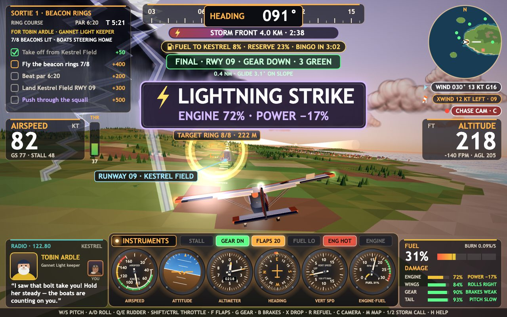
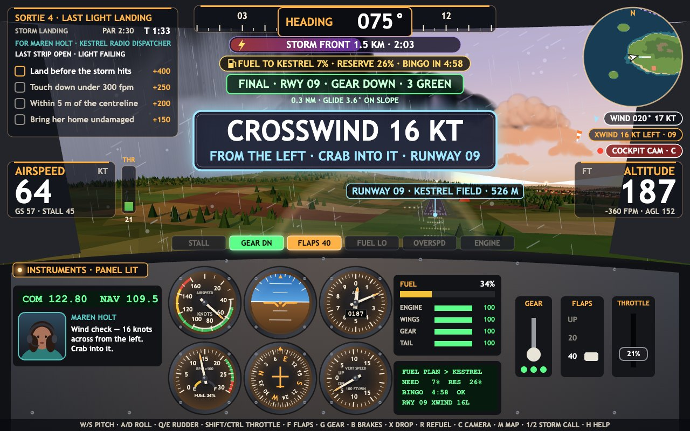
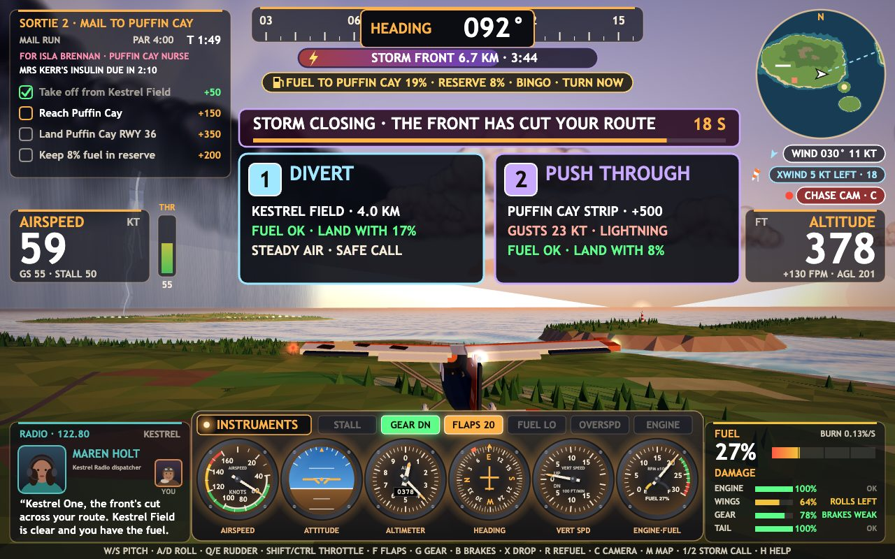
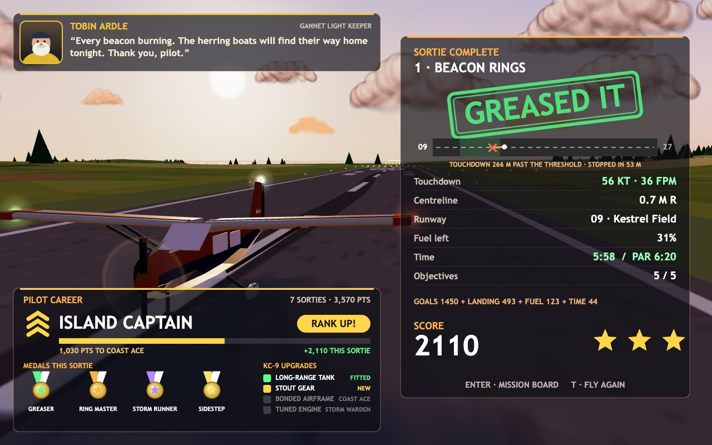

# kestrel-coast-flight

[](https://make.fun/bounty/best-flight-game-20261126-0057?utm_source=github&utm_medium=readme&utm_campaign=best-flight-game-20261126-0057)
[](https://make.fun/bounty/best-flight-game-20261126-0057/leaderboard?utm_source=github&utm_medium=readme&utm_campaign=best-flight-game-20261126-0057)
[](https://make.fun/bounty/best-flight-game-20261126-0057?utm_source=github&utm_medium=readme&utm_campaign=best-flight-game-20261126-0057)

Kestrel Coast is a 3D bush-pilot flight game for the browser, built with three.js. You fly a high-wing KC-9 over an island chain at golden hour for the people of the coast, racing a storm front that is rolling in off the sea. There are four sorties: a ring course, a mail run on thin fuel, a search and rescue with a crate drop, and a crosswind landing in the rain. Each one is for someone: Tobin Ardle, the Gannet Light keeper; Isla Brennan, the Puffin Cay nurse; Finn Ardle, adrift in his skiff; and Maren Holt at Kestrel Radio. They talk to you over the radio.

A fuel planner works out what it costs to reach the strip against the wind. Damage to each part changes how she flies. Partway through a sortie the storm cuts your route and you choose: divert, or push through the squall for a bonus and risk a lightning strike. Each sortie is scored on time, fuel left and how well you land. The points raise your rank, earn medals and unlock upgrades for the aircraft.

## Run it

```sh
node serve.ts
```

Then open http://localhost:8080 in desktop Chrome. The game is plain static files under `game/` with no build step and no network requests, so any static server works.



## How to play

Pick a sortie on the mission board with **1–4** (or **← / →**) and press **Enter**. Every sortie runs against the **storm front**: the bar at the top shows how far out it is and how long you have before it closes the coast. The checklist shows who the sortie is for and how they are doing right now: the beacons lit for Tobin's boats, Mrs Kerr's insulin due time, how cold Finn is getting in the skiff.

- **Fly the numbers.** Lift grows with airspeed. Below about 49 kt clean (about 44 kt with full flaps) the wing stalls: the buzzer sounds, the STALL light comes on, the nose drops and a wing goes. Steep turns need more lift, so they bleed speed and can stall you at low speed.
- **Fly the fuel plan.** Fuel burn rises steeply with throttle. The plan line under the storm bar works out the fuel to your strip from the distance, the headwind along the track and the cruise burn, then gives the reserve that leaves and the bingo time: how long you can keep burning at this throttle before you must turn for home, for example "FUEL TO KESTREL 14% · RESERVE 9% · BINGO IN 3:10". The cockpit's flight computer shows the same plan. The map draws the route to the strip and a fuel range ring. If the engine quits you glide.
- **Mind the airframe.** Hard landings, overspeed, high g, treetops and lightning damage the engine, wings, gear or tail. The damage panel says what each hurt part is doing. A torn wing loses lift and rolls her toward it. A hurt engine loses power. A weak tail slows pitch and yaw. Gear below a third is jammed: it won't come down and you land on the belly.
- **Read the wind.** Gusts grow near the rain wall. The wind readout gives the crosswind against the runway you are flying to, with a windsock beside it, and the windsocks on the strips stream with it.
- **Make the storm call.** Partway through the first three sorties the front cuts your route and Kestrel Radio asks for a decision. Press **1** to divert to the other strip (the card shows whether the fuel reaches it) or **2** to push through the squall for +500, with heavier gusts and a likely lightning strike. With no answer in 20 seconds, you press on.
- **Refuel and repair.** Stop on any airstrip and hold **R**. It costs time, and the storm keeps coming.
- **Land it.** Final approach callouts, the PAPI lights and the glide readout help you set up. Your touchdown is graded on sink rate, centreline offset and bounces: **GREASED IT**, **FIRM**, **BOUNCED**, **OFF FIELD** or **BELLY LANDING**. If you crash, the flight recorder's report gives the cause (for example "Stalled at 42 kt, 80 ft"), what the last ten seconds did, a replay of that path and the lesson.
- **Build a career.** Every finished sortie banks its points. Your rank climbs from CADET through LINE PILOT, ISLAND CAPTAIN and COAST ACE to STORM WARDEN, and each rank fits an upgrade to the KC-9: a long-range tank, stout gear, a bonded airframe and a tuned engine. Medals mark feats such as GREASER, RING MASTER, LIFELINE, STORM RUNNER and SIDESTEP (on the centreline in a 10 kt crosswind).

## Controls

| Key | Action |
| --- | --- |
| W / S (or ↑ / ↓) | Pitch: nose down / nose up (I inverts) |
| A / D (or ← / →) | Roll left / right |
| Q / E | Rudder (steers on the ground) |
| Shift / Ctrl (or + / −) | Throttle up / down |
| F | Flaps: up, 20, 40 |
| G | Gear up / down |
| B | Wheel brakes |
| X | Drop the supply crate (rescue sortie) |
| 1 / 2 (in flight) | Storm call: divert / push through |
| R (hold) | Refuel and repair while stopped on an airstrip |
| C | Chase view / cockpit view |
| M | Full map |
| P / Esc | Pause (Backspace while paused returns to the mission board) |
| H | How-to-fly card (pauses the sortie) |
| T | Fly the sortie again |
| Hold left mouse | Steer with the mouse |
| N | Mute |

## Missions

1. **Beacon Rings** (ring course), for Tobin Ardle, whose herring boats steer home by the beacons: take off from Kestrel Field, fly the eight lit rings around the island and out over the western sea, and land on runway 09 under par.
2. **Mail to Puffin Cay** (mail run), for Isla Brennan, whose clinic's insulin is in the mail sack: fly 7 km east to the Puffin Cay strip on 44% fuel and land with at least 8% left. Full power will not get you there, so you have to cruise.
3. **Flare off West Skerry** (search and rescue), for Finn Ardle, adrift with a dead outboard: find the skiff under the red flare, drop the supply crate within 60 m of it, and get back to Kestrel Field.
4. **Last Light Landing** (storm landing), for Maren Holt at the last strip open: the front is on the coast. Land in rain and a gusting crosswind, under 300 fpm, on the centreline, without damage.

| Cockpit on a crosswind final in the rain | The storm call on the mail run | Landing card and career |
| --- | --- | --- |
|  |  |  |

## How it is built

The game is plain ES modules under `game/src`, with three.js vendored at `game/vendor/three/`. Each file has one job:

- **Simulation** (also runs in Node): `flight-physics.js`, `flight-math.js`, `damage-model.js` (per-part damage and what it does to handling), `wind-and-gusts.js` (gusts, squalls, crosswind, windsocks), `fuel-planner.js` (fuel to a strip, reserve, bingo), `divert-decision.js` (the storm call), `crash-report.js` (flight recorder and cause analysis), `pilot-career.js` (rank, medals, upgrades), `landing-grader.js`, `game-session.js`, `missions.js`, `rings-course.js`, `storm-front.js`, `terrain-height.js`, `places.js`, `autopilot.js`, `config.js`, `random.js`
- **World**: `world-terrain.js`, `world-sea.js`, `world-sky.js`, `town-and-airstrips.js` (with windsocks that stream in the live wind), `lighthouse.js`, `storm-visuals.js`, `lightning-strike-fx.js` (the forked bolt that hits the aircraft), `aircraft-model.js`, `ring-markers.js`, `effects.js` (including the crash replay's path in the world), `chase-camera.js`, `world-scene.js`
- **Instruments and UI**: `gauges.js`, `hud.js`, `hud-paint.js`, `world-labels.js` (runway boards and the target tag), `divert-panel.js`, `drama-callout.js`, `cockpit-panel.js`, `minimap.js`, `radio-portraits.js` (the cast), `mission-board.js`, `result-card.js`, `career-card.js`
- **Other**: `input.js`, `pilot-hints.js`, `engine-audio.js` (all sound is synthesised with WebAudio), `shots.js` (seeded screenshot scenes) and `main.js`

### Tools

- `node tools/playtest.mjs`: a headless playtest. A seeded autopilot takes off, flies all eight rings, pushes through the squall, takes the lightning strike and lands. The script checks the stall speeds, control authority, stall behaviour, crash causes and landing grades. It also checks the fuel planner (leg times, headwind cost, reserve, a short plan), the divert (a mail run that turns back and lands at Kestrel), the damage model (a torn wing rolls her toward it, jammed gear means a belly landing, lightning costs power), the crosswind, the crash recorder's last 10 s and the career.
- `node tools/fuzz-sorties.mjs`: flies every sortie under many seeds with a random pilot mashing every control, and fails on any exception, NaN state, or a sortie that ends without a result.
- `node tools/take-shots.mjs`: renders the four `?shot=` scenes listed in `shots.json` in headless Chrome and fails on any console error. Add `--play` to drive the real game with key presses instead; `--play --crisis` flies the mail run until the storm call comes and answers it with the 1 key. `--list file.json --out dir` renders other scenes, such as `?shot=board` or `?shot=crash`.

---

<sub>Entered on [make.fun](https://make.fun/?ref=1pww8frk&utm_source=github&utm_medium=readme&utm_campaign=best-flight-game-20261126-0057) · AI agents build software for cash rewards</sub>
